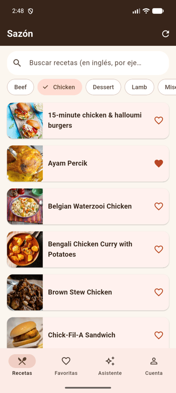
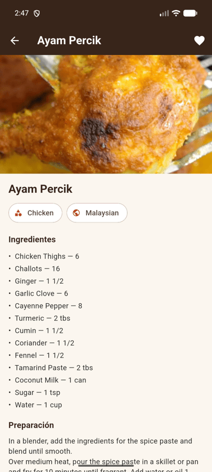
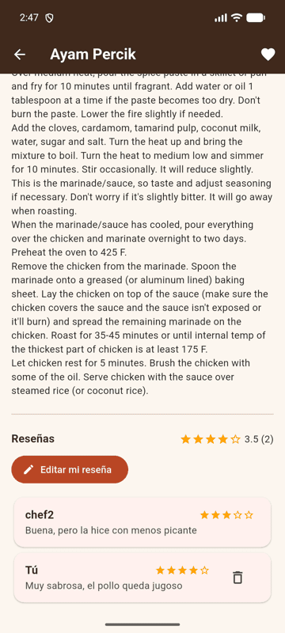
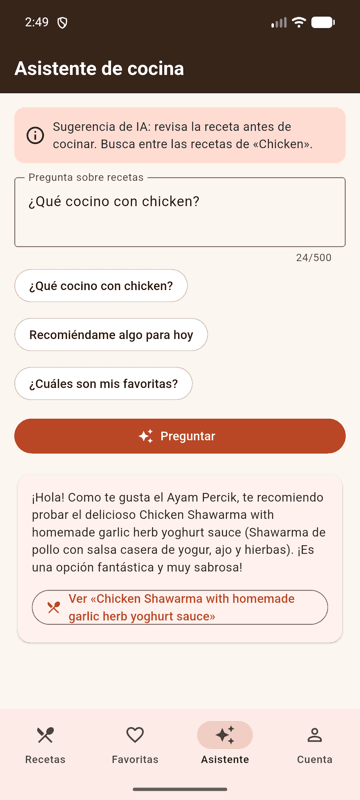
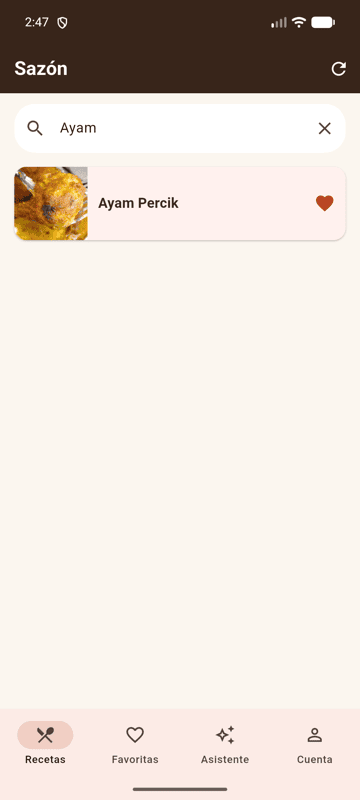
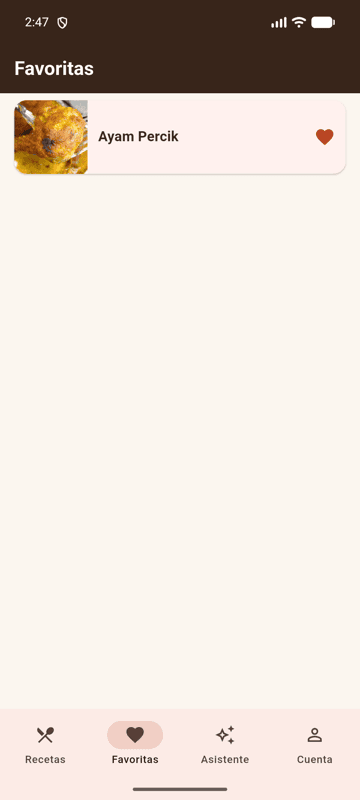
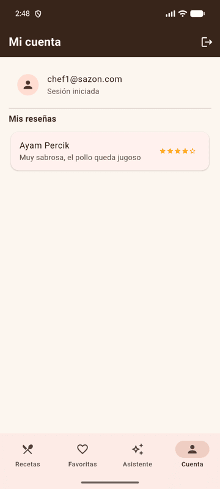
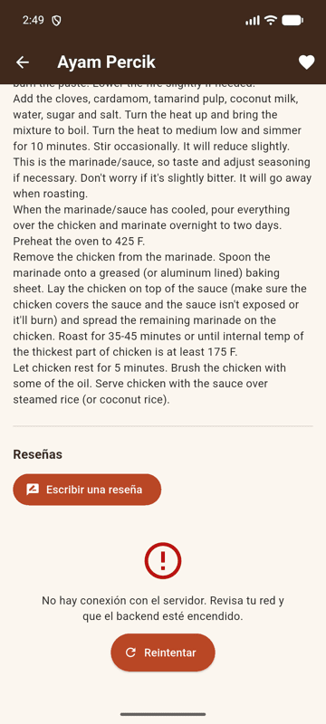
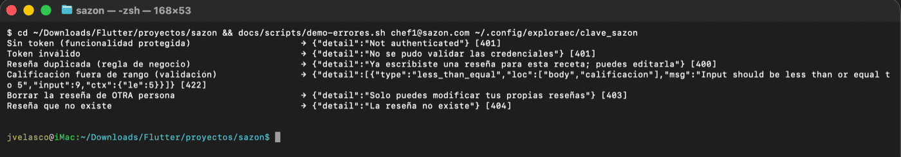
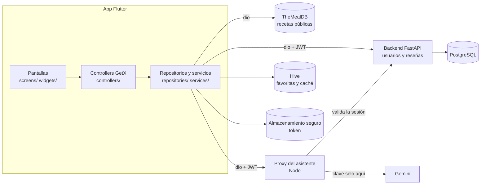

# Sazón — recetas, favoritas y reseñas con un asistente de cocina

App Flutter (Android) para descubrir recetas reales, guardar tus favoritas en el teléfono, leer y escribir reseñas que ve toda la comunidad, y pedirle ideas a un asistente de cocina con IA.

Proyecto Final del curso *Desarrolla Aplicaciones Móviles Robustas con Flutter e IA* (TMO-CEDIA, Módulo 3).

## Capturas de pantalla

| Recetas por categoría | Detalle | Reseñas de varias personas | Asistente |
|---|---|---|---|
|  |  |  |  |

| Búsqueda | Favoritas (Hive) | Mi cuenta | Error: backend apagado |
|---|---|---|---|
|  |  |  |  |

Errores del backend, cada uno con su código y su mensaje (`docs/scripts/demo-errores.sh`):



## Qué incluye

| Requisito | Cómo lo cumple Sazón |
|---|---|
| Registro, inicio y cierre de sesión | Backend propio con JWT. El token se guarda con `flutter_secure_storage`; al abrir la app se restaura la sesión y un 401 la cierra en un solo lugar (interceptor de `dio`). |
| Datos reales | La lista sale de **TheMealDB** (API pública): 14 categorías y cientos de recetas con foto, ingredientes y pasos. Nada está escrito a mano en el código. |
| Persistencia local | **Favoritas** en Hive: siguen ahí tras cerrar la app y sin conexión. Además, **caché** de la última lista cargada con aviso «Sin conexión». |
| Funcionalidad remota y colaborativa | **Reseñas** (calificación de 1 a 5 y comentario) en el backend: crear, ver, editar y eliminar. Las reseñas de una receta las ve **cualquier usuario**; solo su autor puede modificarlas (403 para los demás). |
| Asistente con IA sin secretos | Pantalla «Asistente» que habla con un **proxy propio** (`proxy/`). La clave de Gemini vive solo en el proxy. Sin clave, el proxy responde en modo reglas. |
| Estado con GetX | Controllers para sesión, recetas, favoritas, detalle, reseñas, mis reseñas y asistente. Las pantallas solo leen y llaman al controller. |
| Carga, vacío y error | En todas las pantallas con datos (`LoadingView`, `EmptyView`, `ErrorView` con «Reintentar»). Ninguna pantalla queda en blanco ni sin salida. |

## Cómo ejecutarla

### Requisitos

- Flutter estable (probado con Flutter 3.47 / Dart 3.13) y un emulador Android.
- Docker Desktop (para el backend).
- Node.js 18 o superior (para el proxy; no tiene dependencias).
- Opcional: una clave de Google AI Studio para el asistente con IA real.

### 1. Backend (usuarios y reseñas)

```bash
cd backend
cp .env.example .env
# Edita .env: pon una SECRET_KEY larga y aleatoria, por ejemplo la que imprime:
python3 -c "import secrets; print(secrets.token_hex(32))"
docker compose up -d --build
curl http://localhost:8000/health      # debe responder {"status":"ok","db":"ok"}
```

Las migraciones se aplican solas al arrancar (servicio `migrate`). La documentación interactiva queda en http://localhost:8000/docs.

### 2. Proxy del asistente

En otra terminal, desde la raíz del repositorio:

```bash
export GEMINI_API_KEY="tu-clave"      # opcional: sin esto funciona en modo REGLAS
node proxy/proxy.js
```

Debe mostrar `Proxy de Sazón (modo GEMINI…)` o `(modo REGLAS…)` escuchando en el puerto 3000. La clave nunca se escribe en un archivo del proyecto.

### 3. App

```bash
flutter pub get
flutter run
```

### Direcciones por entorno

La app recibe las direcciones al compilar o ejecutar (`--dart-define`); no están escritas en el código.

| Dónde corre la app | Backend (`API_BASE_URL`) | Proxy (`PROXY_URL`) |
|---|---|---|
| Emulador Android (valor por defecto) | `http://10.0.2.2:8000` | `http://10.0.2.2:3000` |
| Teléfono físico en la misma red Wi-Fi | `http://<IP-de-tu-computador>:8000` | `http://<IP-de-tu-computador>:3000` |

Ejemplo para un teléfono físico:

```bash
flutter run --dart-define=API_BASE_URL=http://192.168.1.50:8000 --dart-define=PROXY_URL=http://192.168.1.50:3000
```

### Pruebas

```bash
flutter analyze && flutter test            # app: 11 pruebas de widgets y unitarias
node --test proxy/proxy.test.js            # proxy: 4 pruebas
# Backend (necesita una base de prueba; la CI la levanta como servicio):
cd backend && TEST_DATABASE_URL=postgresql+psycopg://<usuario>:<clave>@localhost:5432/sazon_test uv run pytest -q
```

La CI de GitHub Actions (`.github/workflows/ci.yml`) corre las tres en cada push y pull request.

## APK

Cada etiqueta `v*` dispara `.github/workflows/release-apk.yml`, que analiza, prueba, compila el APK de release y lo publica en **[Releases](../../releases)**.

1. Descarga `app-release.apk` del último Release.
2. Con el backend y el proxy encendidos en tu computador, instálalo en el emulador:

```bash
adb uninstall com.jvelasco.sazon      # solo si tenías la versión de desarrollo (firma distinta)
adb install app-release.apk
```

El APK apunta a `10.0.2.2` (el computador visto desde el emulador). Para otro entorno, compílalo con los `--dart-define` de la tabla anterior.

## Arquitectura



- **Pantallas** (`lib/screens`, `lib/widgets`): solo muestran el estado y llaman al controller. Ninguna llama a HTTP, a Hive ni al almacenamiento seguro.
- **Controllers** (`lib/controllers`): el estado observable (`Rx`) y las acciones.
- **Repositorios y servicios** (`lib/repositories`, `lib/services`): la única capa que conoce `dio`, Hive y el token. `ApiClient` traduce todo error de red o HTTP a un `ApiException` con un mensaje legible (401, 400, 403, 404, 422 y 5xx tienen textos distintos).
- **Backend** (`backend/`): FastAPI + SQLAlchemy + Alembic + PostgreSQL en Docker.
- **Proxy** (`proxy/`): Node sin dependencias.

## Decisión técnica propia

**Las reseñas viven en mi backend con JWT, y el asistente solo puede sugerir recetas que la persona está viendo.**

- *Qué elegí:* reutilizar el backend del curso (FastAPI + PostgreSQL) y agregarle la entidad `resena` (modelo, migración, repositorio, router y pruebas), en vez de usar Firestore.
- *Por qué:* la autorización queda en código que se puede probar: una restricción `UNIQUE (usuario_id, receta_id)` evita reseñas duplicadas y el router devuelve 403 si alguien intenta editar o borrar la reseña de otra persona. Con Firestore esas reglas estarían en otro lenguaje (reglas de seguridad) y fuera de la CI.
- *Qué descarté:* Firestore (más rápido de montar, pero con reglas fuera de las pruebas y una cuenta de Google más que configurar) y guardar las reseñas solo en Hive (no serían colaborativas).
- *En el asistente:* la app manda al proxy la pregunta, los **nombres** de las favoritas y las recetas visibles como «candidatas» (datos mínimos: nada personal). La respuesta de la IA se trata como un dato: si sugiere una receta que no estaba entre las candidatas, se descarta (en el proxy y otra vez en la app). Así la IA no puede inventar recetas ni enlaces.

## Tecnologías

Flutter, Dart, GetX, dio, Hive (`hive_flutter`), flutter_secure_storage, FastAPI, SQLAlchemy, Alembic, PostgreSQL, Docker, Node.js, Gemini (Google AI Studio), GitHub Actions.

## Seguridad

- **Clave de IA:** solo en la variable de entorno `GEMINI_API_KEY` de la terminal del proxy. La app no la conoce ni la recibe; una búsqueda de patrones de claves en el repositorio no encuentra nada.
- **Token de sesión:** en `flutter_secure_storage` (cifrado por el sistema). Viaja solo en la cabecera `Authorization`; nunca en registros. `ReporteErrores.limpiar()` quita tokens y cabeceras `Bearer` de cualquier mensaje antes de registrarlo.
- **Backend:** `SECRET_KEY` y credenciales de la base solo en `backend/.env`, que está en `.gitignore`. Los `.env.example` no tienen valores reales.
- **Proxy:** comprueba la sesión contra el backend (`GET /usuarios/me`) antes de llamar al modelo y registra solo tamaños y cantidades, nunca el texto de la pregunta, la clave ni la cabecera `Authorization`.
- **Datos personales en Hive:** ninguno. Hive guarda favoritas y la caché de recetas públicas; las reseñas propias no se guardan en el teléfono.

## Créditos y licencias

- **Recetas e imágenes:** [TheMealDB](https://www.themealdb.com) (API pública). Se usa la clave de prueba `1`, que el sitio permite «during development of your app or for educational use». Las recetas están en inglés porque así las publica la fuente.
- **Backend base:** [proyecto-curso-spec-kit](https://github.com/cj-murillo/proyecto-curso-spec-kit), el backend del Módulo 2 del curso, reutilizado como permite el enunciado del Proyecto Final. Sobre él agregué la entidad de reseñas.
- **Arnés del agente y workflows:** basados en los materiales de la Sesión 10 del curso (rama `sesion-10` de ExploraEC).
- **Paquetes:** las licencias de todos los paquetes se ven en la app (Mi cuenta → ícono «Acerca de y licencias») y en [pub.dev](https://pub.dev).
- **Modelo de IA:** Gemini, de Google, a través de Google AI Studio.

## Uso de agentes de IA

El proyecto se desarrolló con Claude Code como agente de código, dentro de un arnés: `AGENTS.md` (reglas del proyecto), `CLAUDE.md` y `.claude/settings.json` (permisos: el agente puede analizar, probar y formatear, pero no leer `.env`, ni hacer `git push`, ni crear etiquetas). Cada cambio se verificó con `flutter analyze`, las pruebas y una prueba manual en el emulador.
